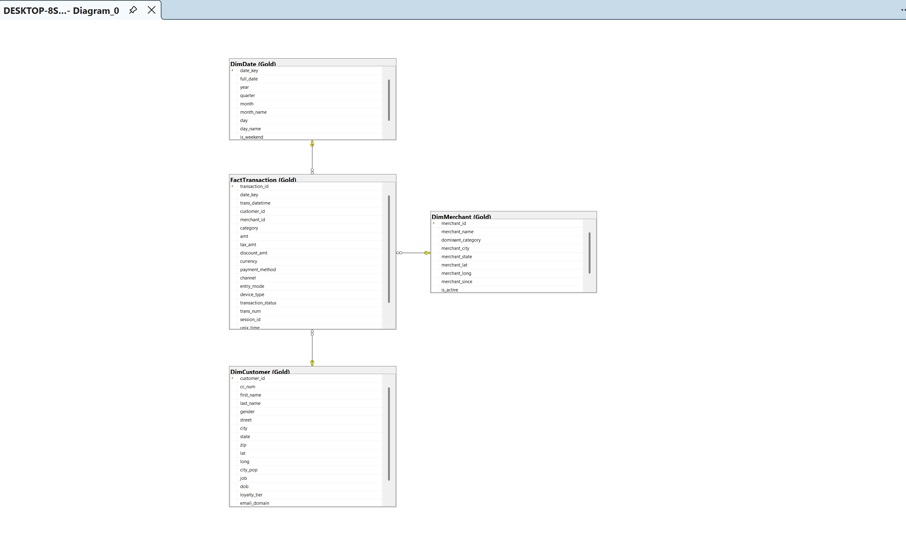
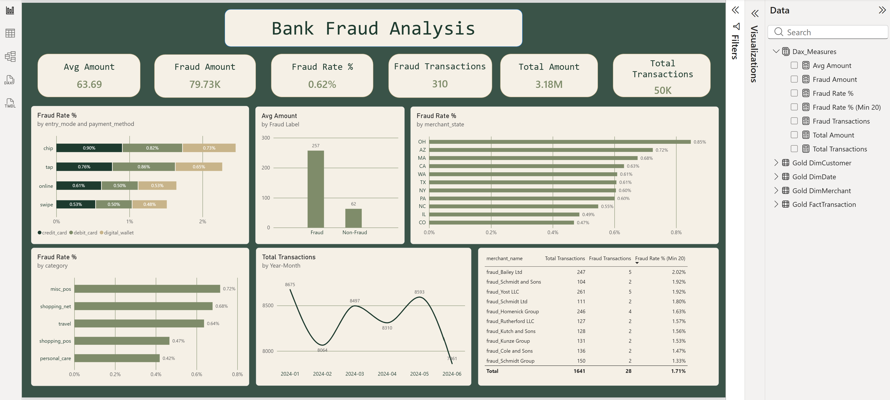

# Bank Card Fraud Detection: Data Warehouse & Dashboard

End-to-end data project: raw CSV files, loaded into SQL Server and modeled with the Bronze / Silver / Gold architecture, then analyzed in a Power BI dashboard.

## Dataset

Synthetic bank card transactions for fraud detection, provided as part of the course project.

| Table | Description | Rows |
|---|---|---|
| `customers` | Customer profiles (demographics, loyalty tier, signup date) | 1000 |
| `merchants` | Merchants across 14 categories | 400 |
| `transactions` | Card transactions, USD only, with an `is_fraud` flag | 50,000 |

> The raw CSV files are not included in this repository.

## Architecture

```
CSV files -> Bronze (raw) -> Silver (cleaned) -> Gold (star schema) -> Power BI
```

| Layer | Purpose |
|---|---|
| Bronze | Raw data loaded as-is, no changes |
| Silver | Cleaning: TRIM, type conversion, handling blanks and invalid values |
| Gold | Star schema ready for analysis |


## Data Model (Gold)

Star schema with one fact table and three dimensions:

- `FactTransaction`: one row per transaction (50,000 rows)
- `DimDate`: generated from the min/max transaction date
- `DimCustomer`: customer attributes
- `DimMerchant`: merchant attributes

Descriptive transaction attributes (`payment_method`, `channel`, `entry_mode`, `device_type`, `transaction_status`, `category`) are kept in the fact table because each has only a few distinct values.



## Data Quality Checks & Decisions

Every table was validated in Bronze before cleaning (`sql/2-validation.sql`): blanks, failed type conversions, duplicates, orphan keys, invalid categories and illogical values.

| Table | Finding | Action |
|---|---|---|
| customers | 189 blank `loyalty_tier` | Set to `None` (assumed no membership) |
| customers | 8 blank `zip` | Kept `zip` as text, blanks stored as empty string |
| customers | 7 rows with `signup_date` earlier than `dob` (1-2 years apart) | `signup_date` set to NULL, `dob` kept (correct date cannot be determined) |
| customers | No duplicates, `gender` has only F / M | No change |
| merchants | No duplicates, no conversion failures, consistent categories | TRIM + type conversion |
| transactions | No nulls, duplicates or orphan keys; currency is USD only | TRIM + type conversion |
| transactions | Fraud rows are the most important rows | No rows removed |

## Dashboard



### Key Insights

- **Fraud is rare but costly:** 310 of 50,000 transactions (0.62%) are fraudulent, yet they account for about 2.5% of total transaction value (79.73K of 3.18M).
- **Fraudulent transactions are much larger:** the average fraud amount is about 257 versus about 62 for normal transactions (roughly 4x), making transaction amount the strongest fraud indicator in this data.
- **Entry mode shows a slight tendency:** chip and tap payments reach fraud rates up to 0.90%, while online and swipe stay between 0.48% and 0.61%. The differences are small.
- **No single region or category drives fraud:** fraud rate ranges from 0.47% to 0.85% across states and from 0.42% to 0.72% across merchant categories.
- **Merchant-level counts are small:** top merchants by fraud rate have only 2 to 5 fraud transactions each, so that list is for review, not a conclusion.

### Limitations

- The dataset is synthetic, so some patterns are flat and should not be generalized to real-world fraud.
- Fraud is highly imbalanced (0.62%), which matters for any future detection model.

## How to Run

1. Create a database and load the three CSV files into the `Bronze` schema.
2. Run the SQL files in order:
   - `sql/1-bronze_load.sql`
   - `sql/2-validation.sql`
   - `sql/3-silver_layer.sql`
   - `sql/4-gold_layer.sql`
3. Open `powerbi/fraud_dashboard.pbix`, update the SQL Server connection, and refresh.

## Repository Structure

```
├── README.md
├── sql/
│   ├── 1-bronze_load.sql
│   ├── 2-validation.sql
│   ├── 3-silver_layer.sql
│   └── 4-gold_layer.sql
├── powerbi/
│   └── fraud_dashboard.pbix
└── docs/
    ├── data_flow.png
    ├── data_model.png
    └── dashboard.png
```

## Tools

SQL Server (T-SQL), Power BI (DAX)
